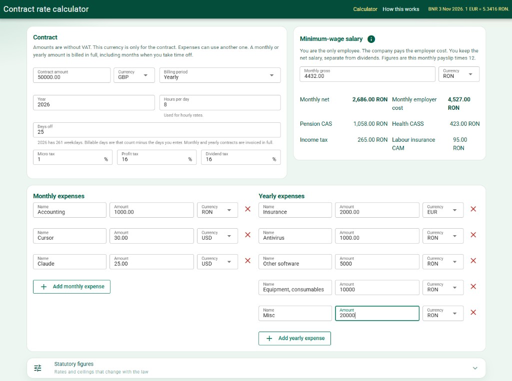
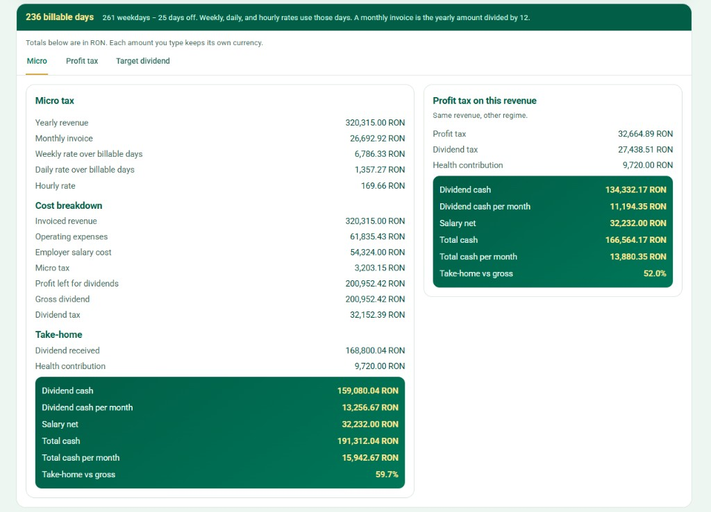

# Contract rate calculator


Estimate take-home pay for a Romanian SRL freelancer. You enter a contract, days off, salary, and costs. The app shows micro tax, profit tax, dividend tax, the health contribution on dividends, and the rates you need for a dividend target.

This is not tax, accounting, or legal advice.

## Screenshots

Contract, salary, and expenses:



Micro vs profit take-home for the same revenue:



## Run locally

```bash
npm install
npm run dev
```

Open the URL Vite prints (usually `http://localhost:5173`).

```bash
npm test
npm run build
```

## What it stores

Your figures stay in this browser. Saves go to **IndexedDB** and are mirrored in **localStorage** when that works. Nothing is uploaded to an account.

Exchange rates are fetched from [cupiu.ro](https://cupiu.ro/api/rates/), which republishes the BNR fixing. That request leaves the browser. Contract amounts do not.

## License

MIT. Free to use, copy, and change. Keep the copyright notice when you share it. See [LICENSE](LICENSE).
